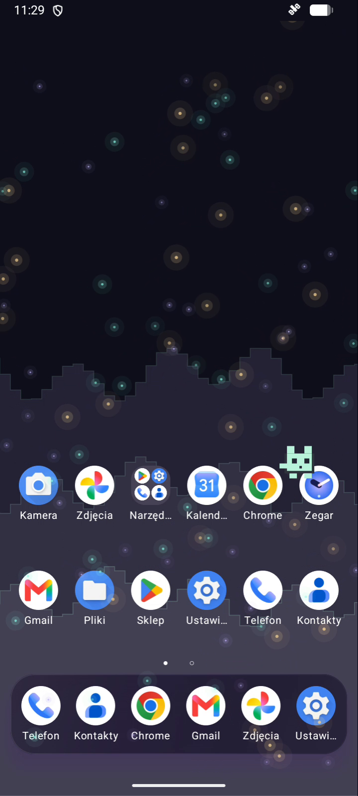
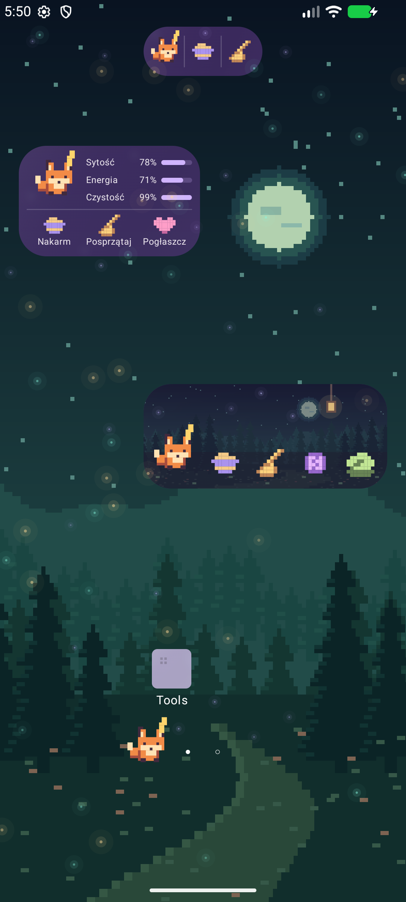
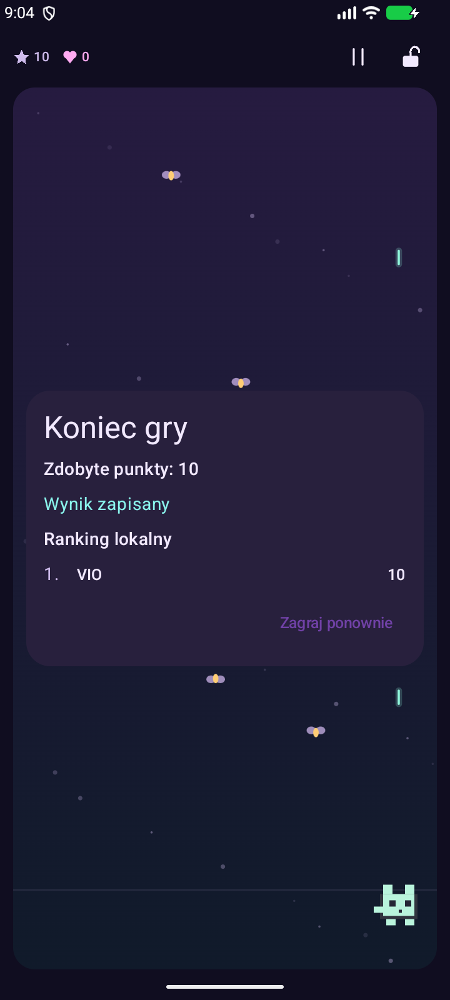
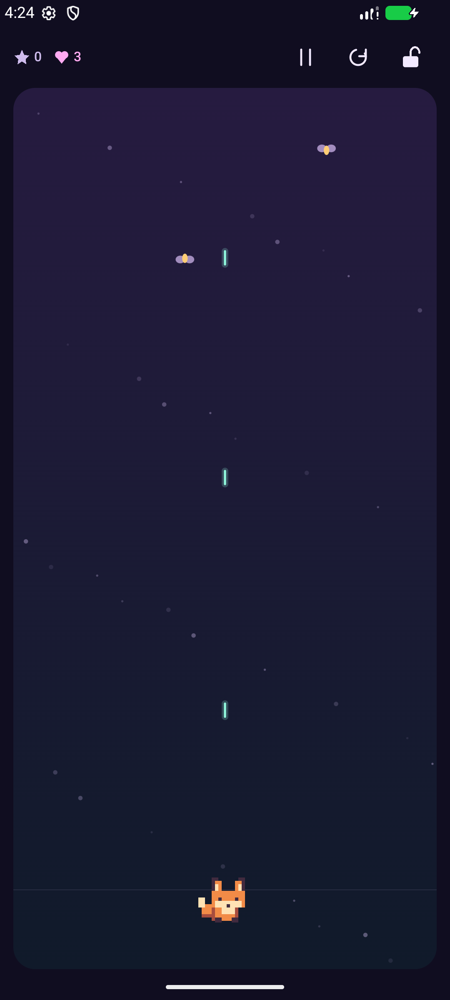

# Violet Glass Launcher

Android launcher with configurable home screens, a glass theme, app categories, widgets and an optional animated desktop companion. Choose Polish or English in Launcher settings → App language.

- Customize the app grid, dock, folders, gestures and icon packs.
- Open the app drawer with a swipe up and close it with a swipe down from the top of the list.
- Add a Home Assistant dashboard in a separate panel. Set your server address and view in launcher settings.
- Enable the companion and wallpaper effects independently. Notification badges and the companion envelope use Android notification access when the user grants it.
- Export layout and preferences as JSON. Restored Android widgets need to be bound again.

## Screenshots

<p>
  
  
  
  
</p>

## Build from source

Use OpenJDK 17 or newer, the Android SDK Platform 37 and the checked Gradle wrapper. The app requires Android 12 (API 31) or newer. Set `ANDROID_HOME` to your SDK installation.

```sh
./gradlew :app:testStandardDebugUnitTest :app:assembleStandardRelease
./gradlew :app:testFdroidDebugUnitTest :app:assembleFdroidRelease
```

The `standard` variant has an optional experimental Google Discover integration that needs the installed Google app and may need the separate AIDL Bridge. The `fdroid` variant omits Discover. Release tasks generate unsigned APKs. Debug builds for local testing are available with `:app:assembleStandardDebug` and `:app:assembleFdroidDebug`.

## Privacy and setup

Home Assistant connects to the server you configure. Notification indicators process Android metadata locally. The backup contains the launcher layout, preferences and selected notification source packages. It leaves the Home Assistant address and session, notification contents and wallpaper image on the device.

To set up the launcher, install a signed build and select Violet Glass as your default Home app in Android settings.

## License

Violet Glass is available under the [Apache License 2.0](LICENSE).
